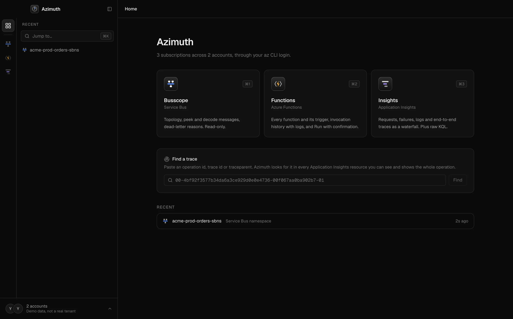
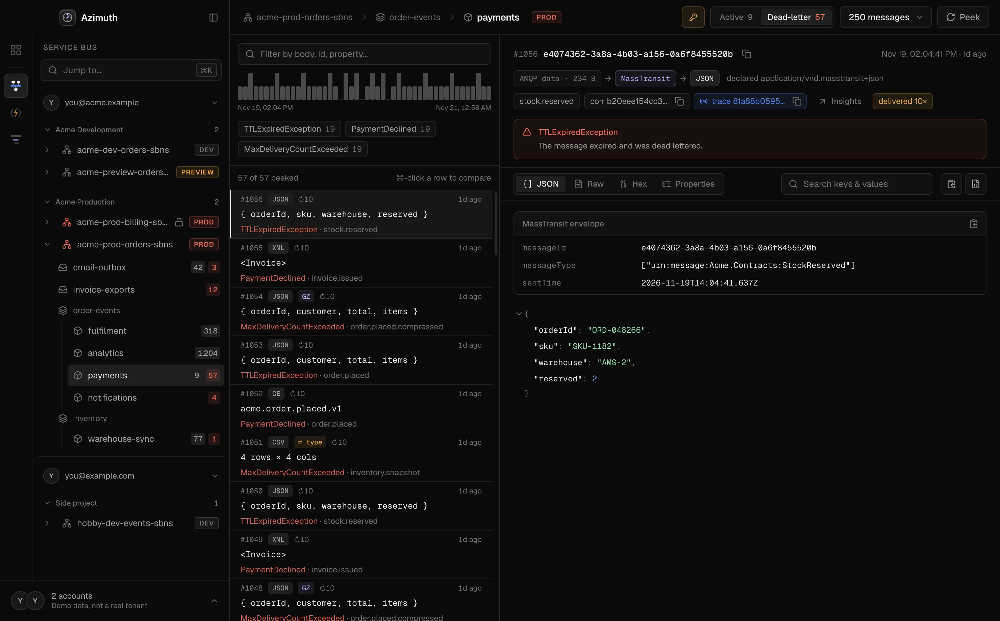
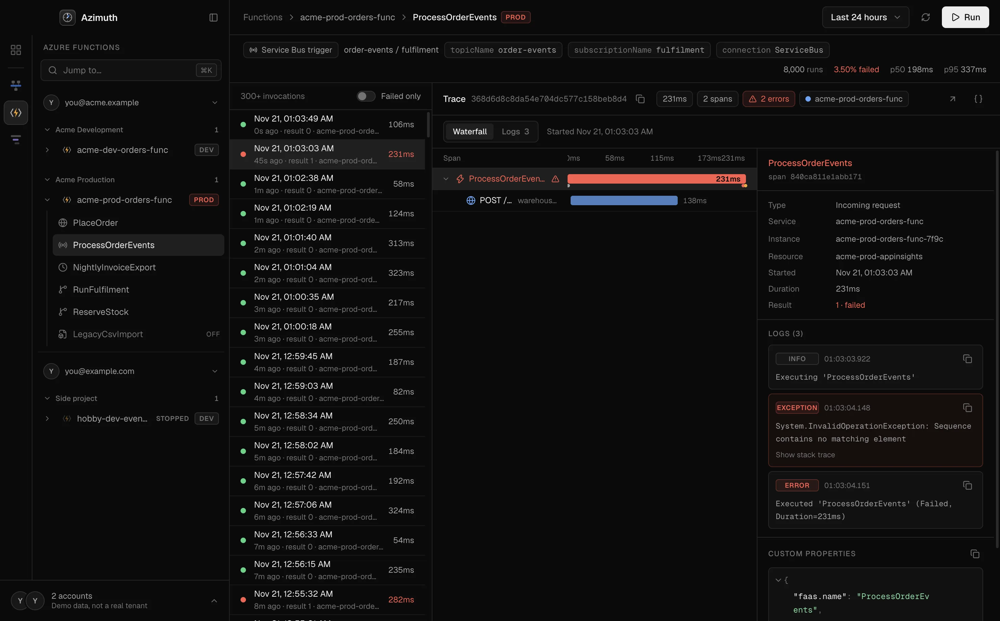
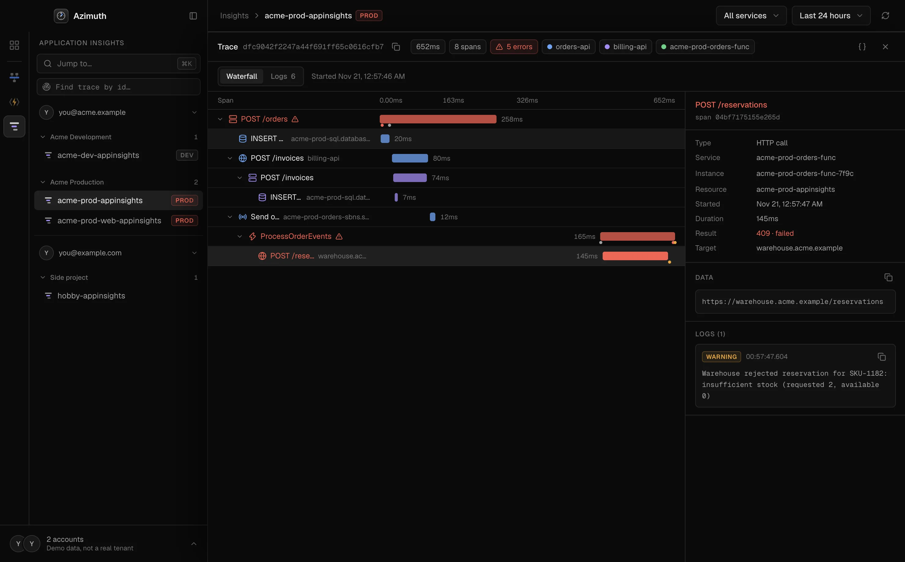
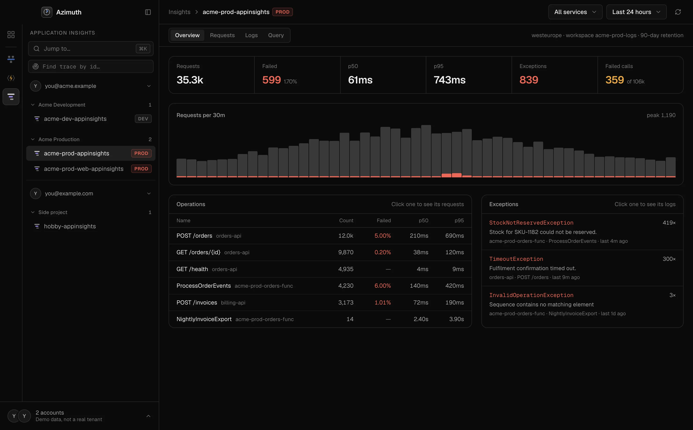

<p align="center"></p>

<h1 align="center">Azimuth</h1>

<p align="center">A fast desktop console for Azure: Service Bus, Functions and Application Insights, signed in through your az CLI.</p>



The Azure portal is slow and scatters one problem across five blades. Azimuth puts the things you check while debugging side by side in one window, with the same look in every tool:

- **Busscope** for Service Bus: topology, peek and decode messages, dead-letter reasons. Read-only.
- **Functions**: every function and its trigger, invocation history, the full trace of any invocation, and Run with confirmation.
- **Insights** for Application Insights: requests, failures and logs, any operation as a waterfall across services, and raw KQL.

They link to each other. A Service Bus message with a `traceparent` opens its trace in Insights. A function invocation opens with every call it made and every log it wrote. Paste any trace id into Find trace and Azimuth searches every Application Insights resource you can see.

## Busscope (Service Bus)


- **Topology.** Topics, subscriptions, dead-letter queues and auto-forward targets as a graph. Arrows carry each subscription's filter; hover for the full SQL or correlation filter and what it means.
- **Decoding in steps.** Unwraps gzip, base64, byte-order marks, double-encoded JSON, CloudEvents and MassTransit envelopes, then shows a JSON tree, XML tree, CSV table or hex dump based on what the bytes really are. If the declared `Content-Type` disagrees with the body, it says so.
- **Readable dead letters.** Grouped by reason, a clickable histogram of enqueue times, delivery counts next to the payload.
- **Diff** two messages (⌘-click, or Ctrl+click on Windows and Linux), and **copy** any value, its JSONPath, the payload or the whole message.



Busscope only peeks. Peeking doesn't lock messages or change delivery counts, and there are no send, complete or purge actions.

## Functions



- **Every function app and function** in your subscriptions, with its trigger in plain words: `POST /api/orders`, `order-events / fulfilment`, `Every day at 02:00`.
- **Numbers per function** for the chosen time range: runs, failure rate, p50, p95, last run.
- **Invocation history.** Pick an invocation to see its trace: dependency calls, logs and exceptions with stack traces.
- **Live logs** for the whole app.
- **Run.** HTTP functions get a real request (method, path, query, headers, body). Other triggers go through the host's admin endpoint, like the portal's Test/Run. After the response, Azimuth waits for the invocation to reach Application Insights and selects it, with its trace.

Run is the only thing in Azimuth that changes anything, so it's careful:

- It is sent once and never retried.
- Production apps (a name containing `prod`) need the app name typed back. The main process checks this too, not only the UI.
- Function keys are fetched in the main process for each run, held in memory, and never shown or written to disk.
- Durable activities, orchestrators and entities can't be run directly, so Run is disabled for them, as it is for disabled functions and stopped apps.
- Running needs permission to read the app's keys (Website Contributor or Contributor). With Reader you still get history, traces and logs.

**Finding the app's telemetry.** With OpenTelemetry, telemetry often names the service rather than the function app, so Azimuth looks in this order: the instrumentation key in the app's settings, if you can read them; otherwise it asks each Application Insights resource in the subscription which service ran these function names in the last 3 days (one small query each, six at a time); otherwise you pick it once and Azimuth remembers.

## Insights (Application Insights)



- **Overview.** Requests, failure rate, p50 and p95, exceptions and failed dependency calls, a timeline, top operations and top exceptions. Filter by service (`cloud_RoleName`) when several apps share a resource.
- **Requests and Logs** with filters, and a live tail that polls every 10 seconds for newer entries only.
- **Traces.** Requests and dependencies nested by parent span, logs pinned to the span that wrote them, service colours, and a detail pane with properties and stack traces. If part of an operation was logged to another resource, **Look in other resources** stitches it together.
- **Query.** Write KQL against the resource, with examples, CSV and JSON export, and a click-through to any row's trace.



Every built-in query is limited by the time range and a row cap, and KQL can't change data, so browsing production is safe. Free-form queries are capped at 10,000 rows. Telemetry takes 30 seconds to 3 minutes to reach Application Insights, so live means recent, not instant.

## Run it

You need Node 22.12 or newer and, for real data, the [Azure CLI](https://learn.microsoft.com/cli/azure/install-azure-cli) signed in with `az login`.

```bash
git clone https://github.com/chan27-2/azimuth.git
cd azimuth
npm install        # also downloads Electron and names the dev bundle Azimuth
npm start          # builds the UI and opens the app
```

There are no packaged builds yet; you run it from source. To try it without Azure, `npm run demo` uses a made-up "Acme" estate for all three tools. For hot reload: `npm run dev` (or `npm run dev:demo`).

Panes, list columns and side panels resize by dragging their edge (double-click to reset), side panels collapse, and every breadcrumb level is clickable. Logs and message bodies are formatted when Azimuth recognises the format: JSON (even inside a sentence), XML, SQL and stack traces.

Shortcuts: ⌘K (Ctrl+K) jumps to anything, ⌘1 / ⌘2 / ⌘3 switch tools, ⌘0 goes home, ⌘B toggles the sidebar, ⌘[ goes up a level.

## Sign-in and permissions

Azimuth uses your az CLI login. If `az` is signed in to several accounts or tenants (`az account list --all`), every subscription shows up, grouped by account, and each token is requested as the account that owns that subscription. The accounts menu at the bottom of the sidebar chooses which accounts and subscriptions every tool shows, and **Add account** runs `az login` (press Cancel if you close the browser instead).

What you can do depends on your Azure roles, and Azimuth checks before trying, so it can explain instead of failing:

| | Needs |
|---|---|
| Lists, counts, topology, history, traces, logs, KQL | Reader |
| Peek Service Bus messages | Azure Service Bus Data Receiver, or rights to read the namespace's SAS key, or a connection string you paste (kept in memory only) |
| Run a function | Permission to read the app's keys (Website Contributor or Contributor) |

## Under the hood

Electron, React 19, Tailwind CSS 4, Motion, React Flow and TanStack Virtual. All Azure calls happen in the main process (`electron/`): the window can only call the channels listed in `electron/main.js`, and secrets never cross into it. Reads retry on throttling with backoff; anything that changes state is sent once. Application Insights is queried through the ARM query endpoint with the same token as everything else.

```
electron/core.js        az accounts, credentials, ARM client, permissions
electron/servicebus.js  Busscope
electron/functions.js   Functions, including Run
electron/insights.js    Application Insights queries
electron/demo/          fictional data for npm run demo
src/ui/                 the shared design system
src/shell/              sidebar, tool rail, home, ⌘K
src/tools/              one folder per tool
```

The message format detector is [`src/tools/servicebus/detect.ts`](src/tools/servicebus/detect.ts). The app icon is drawn by [`brand/make_icon.swift`](brand/make_icon.swift).

## License

[MIT](LICENSE)
