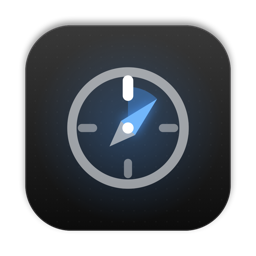
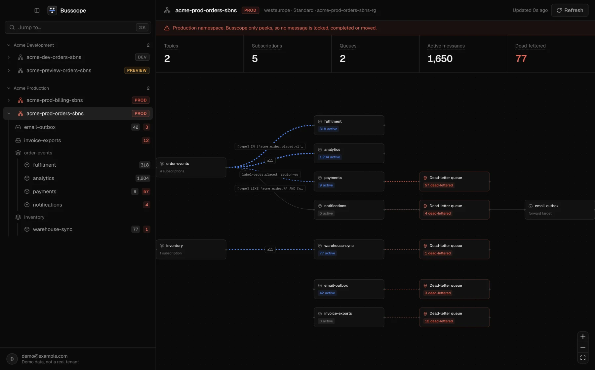
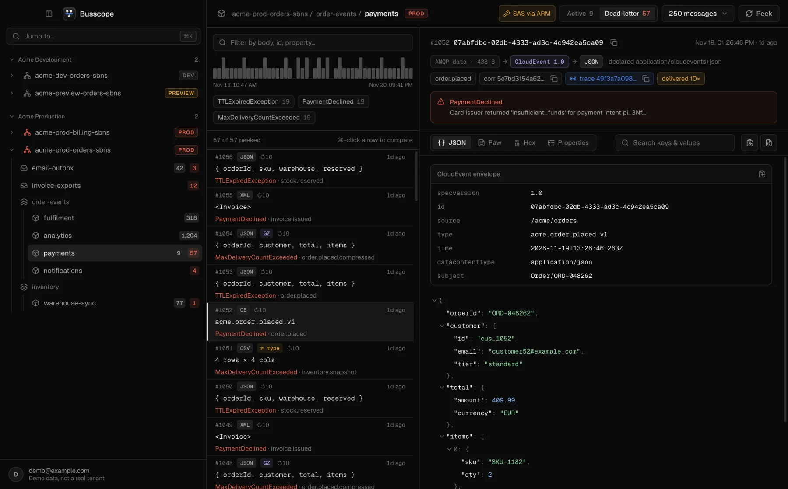
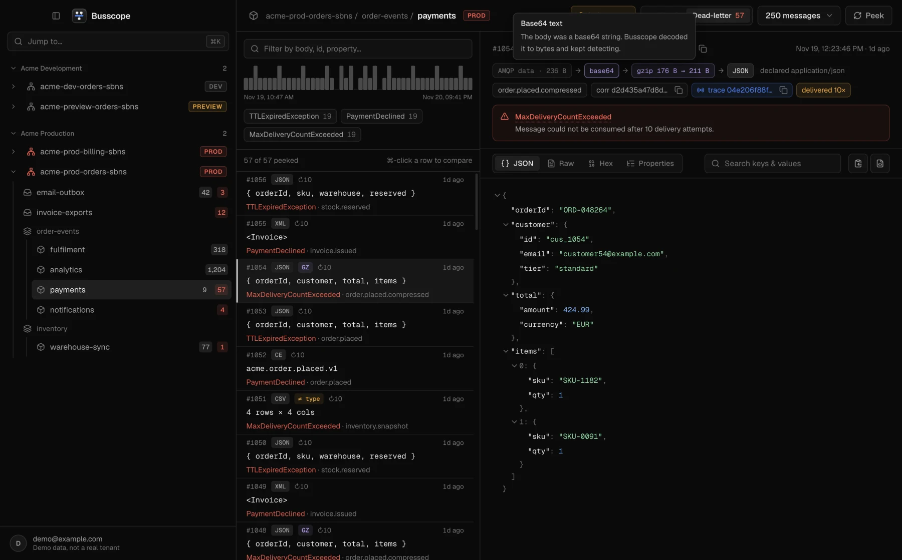
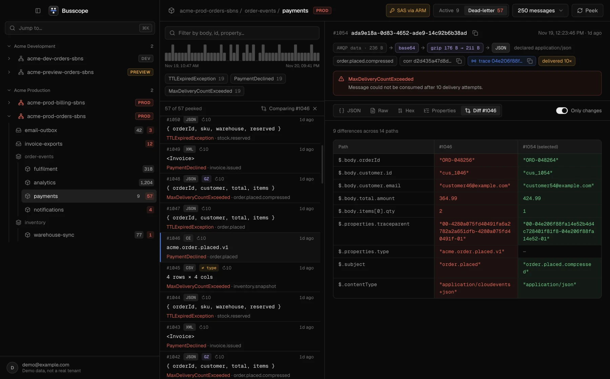
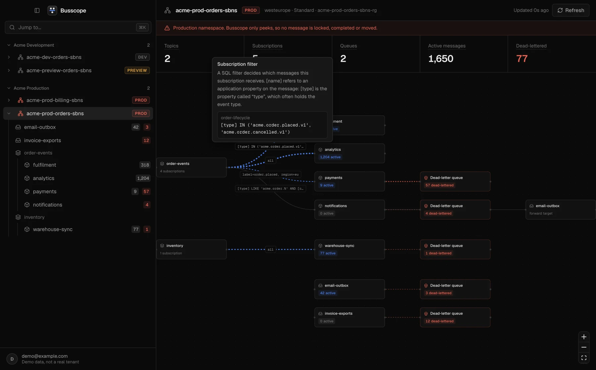

<p align="center"></p>

<h1 align="center">Busscope</h1>

<p align="center">A desktop explorer for Azure Service Bus that works out what's inside your messages.</p>



Most Service Bus tools show a message body as a block of text. Busscope decodes it. It unwraps gzip, base64, CloudEvents and MassTransit envelopes, then shows the payload as a JSON tree, an XML tree, a CSV table or a hex dump, depending on what the bytes really contain. It signs in with your existing `az login`, finds every namespace you can see, and only peeks. It never locks, completes or moves a message.

## What it does

- **Finds your namespaces.** Lists every subscription and Service Bus namespace your az CLI identity can see. Namespaces whose names contain `prod`, `preview`, `dev` or `ci` get a matching badge.
- **Maps the topology.** Each namespace is drawn as a graph: topics, subscriptions, dead-letter queues and auto-forward targets. Arrows carry the subscription's filter rule. Hover an arrow to read the full SQL or correlation filter and what it means. Nodes can be dragged.
- **Decodes each message in steps.** The detail pane shows every step, for example `AMQP data → base64 → gzip 176 B → 211 B → JSON`. If the declared `Content-Type` disagrees with the body, Busscope says so.
- **Makes dead letters readable.** Messages are grouped by dead-letter reason, there's a histogram of enqueue times you can click to filter, and the delivery count and error description sit next to the payload.
- **Diffs two messages.** ⌘-click a second message to compare payloads and properties path by path, e.g. a failed message against one that went through.
- **Lets you copy anything.** One click copies a single value, its JSONPath, the decoded payload, or the whole message (body, broker properties and application properties) as JSON.
- **Explains itself.** Most labels have a tooltip in plain English: what `[type]` in a filter refers to, what an AMQP data section is, why a message hit `MaxDeliveryCountExceeded`.

| | |
|---|---|
|  |  |
|  |  |

## Run it

You need Node 22.12 or newer and, for real data, the [Azure CLI](https://learn.microsoft.com/cli/azure/install-azure-cli) signed in with `az login`.

```bash
git clone https://github.com/chan27-2/busscope.git
cd busscope
npm install        # also downloads the Electron binary
npm start          # builds the UI and opens the app
```

There are no packaged builds yet; you run it from source.

To try it without Azure, run the demo, which uses a made-up "Acme" estate:

```bash
npm run demo
```

For development with hot reload: `npm run dev` (or `npm run dev:demo`).

## How it signs in

Busscope uses `AzureCliCredential`, so it is whoever `az account show` says you are. It lists namespaces through Azure Resource Manager and peeks messages over AMQP.

Peeking needs the **Azure Service Bus Data Receiver** role (or Owner). If your identity doesn't have that role but does have management rights on the namespace (Contributor), Busscope falls back to reading the namespace's `RootManageSharedAccessKey` over ARM and peeking with it. The key stays in memory and the header shows a **SAS via ARM** badge whenever it's in use. If you'd rather not use the fallback, ask for the data role.

Busscope is read-only. It peeks, which doesn't lock messages or change delivery counts, and it has no send, resend, complete or purge actions.

## Format detection

For each message, Busscope:

1. Notes the declared `ContentType`, but treats it only as a hint.
2. Unwraps layers and runs detection again after each one: gzip (`1F 8B`), base64 text, a UTF-8 byte-order mark, double-encoded JSON strings, CloudEvents (`specversion`, with `data` or `data_base64`) and MassTransit envelopes.
3. Sniffs the result: JSON, XML, CSV (consistent delimiter), plain text, or binary. For binary it looks at magic bytes for Avro, ZIP, PDF and PNG, and guesses MessagePack or Protobuf.
4. Falls back to a hex view. Protobuf can't be decoded without a schema.

The detector is a single file, [`src/lib/detect.ts`](src/lib/detect.ts).

## Stack

Electron, React 19, Tailwind CSS 4, Motion, React Flow and TanStack Virtual. On the Azure side it uses `@azure/service-bus`, `@azure/arm-servicebus` and `@azure/identity`. The app icon is drawn by [`brand/make_icon.swift`](brand/make_icon.swift).

## License

[MIT](LICENSE)
